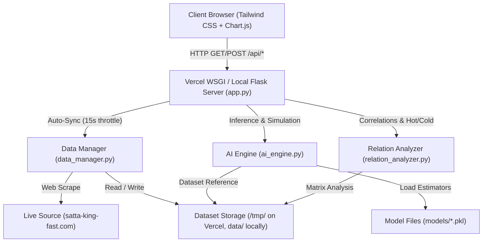
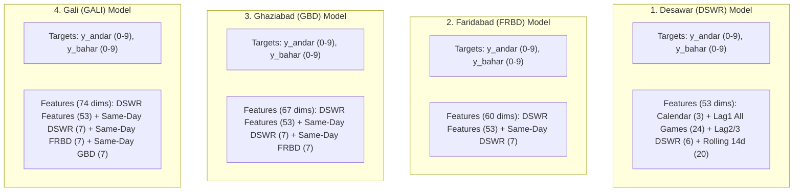
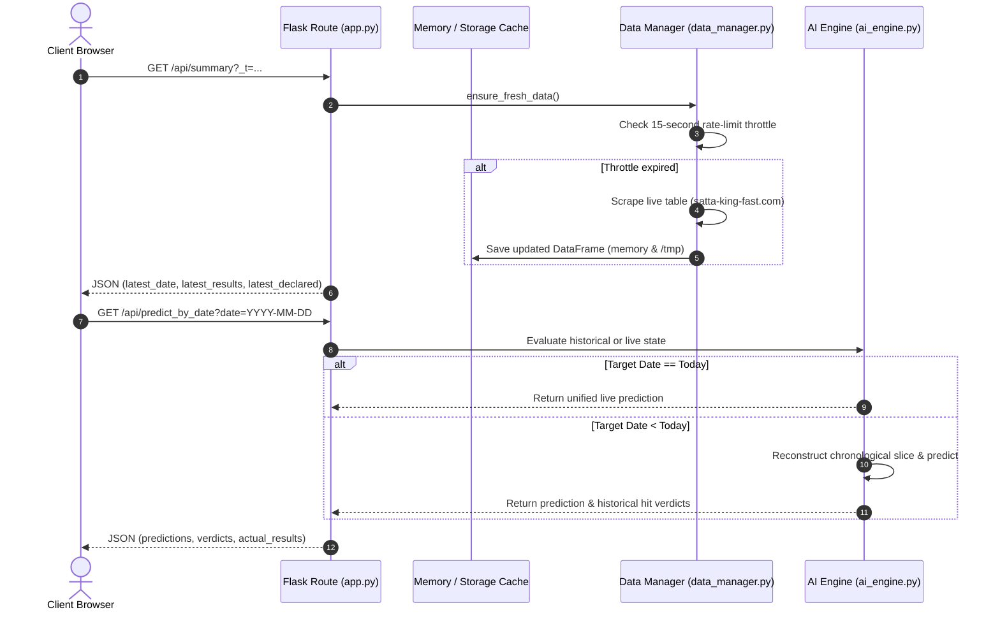

# Project Logic Documentation: Number Prediction & Game Relation Analyzer

A comprehensive technical reference and architectural guide for developers working on the **Number Prediction & Game Relation Analyzer** system.

---

## 1. Project Overview

### 1.1 Purpose
The project is a data analysis, statistical relation, and machine learning prediction platform for four daily sequential draw games:
1. **Desawar (DSWR)** — 5:00 AM
2. **Faridabad (FRBD)** — 6:15 PM
3. **Ghaziabad (GBD)** — 8:30 PM
4. **Gali (GALI)** — 11:30 PM

It ingests 12 years of historical draw data (2015–2026, 4,310+ days), computes pairwise Pearson correlations, digit transfer probabilities, and Rashi mirror symmetry, and trains dual-ensemble machine learning models to forecast upcoming jodis (two-digit numbers 00–99), solid Andar/Bahar digits (0–9), and 6-digit crossing boxes.

### 1.2 Technology Stack
- **Backend:** Python 3.10+ with Flask (REST API, routing, serverless WSGI).
- **Machine Learning & Analytics:** Scikit-Learn (`RandomForestClassifier`, `HistGradientBoostingClassifier`), NumPy, Pandas, SciPy, Joblib.
- **Web Scraping:** BeautifulSoup4, Requests (parallelized thread pool scraping).
- **Frontend:** HTML5, Tailwind CSS (via CDN), Chart.js (interactive frequency visualization), FontAwesome 6.
- **Deployment:** Vercel Serverless (`@vercel/python`) with `/tmp` filesystem fallback and local multi-threaded development server.

### 1.3 System Architecture



---

## 2. Project Structure

```
d:\S K\
├── api/
│   └── index.py               # WSGI entrypoint for Vercel Serverless
├── data/
│   ├── all_games_dataset.csv  # Primary 12-year historical dataset (2015-2026)
│   └── history_frbd_original.csv # Preserved baseline user history dataset
├── models/                    # Compressed Scikit-Learn model binaries
│   ├── DSWR_predictor.pkl     # Predictor for Desawar (~4.9 MB)
│   ├── FRBD_predictor.pkl     # Predictor for Faridabad (~4.9 MB)
│   ├── GALI_predictor.pkl     # Predictor for Gali (~5.1 MB)
│   └── GBD_predictor.pkl      # Predictor for Ghaziabad (~4.9 MB)
├── templates/
│   └── index.html             # Responsive SPA dashboard (Tailwind + Chart.js)
├── ai_engine.py               # Dual-ensemble ML classifiers, feature engineering & inference
├── app.py                     # Flask web server, route definitions, caching & sync orchestration
├── data_manager.py            # Web scraping, dataset consolidation & filesystem compatibility
├── relation_analyzer.py       # Statistical correlations, digit transfer rates & Rashi logic
├── requirements.txt           # Production Python dependencies
├── run_dashboard.bat          # 1-click local launch script (port 8080)
├── push_to_github.bat         # Git push synchronization utility
├── vercel.json                # Vercel deployment and routing configuration
└── README.md                  # High-level user documentation
```

### Folder Responsibilities:
- **`data/`**: Holds normalized historical records. Each row contains 5 columns: `date,DSWR,FRBD,GBD,GALI`.
- **`models/`**: Stores pre-trained model weights serialized via `joblib(compress=3)`.
- **`templates/`**: Holds client-side presentation code and real-time JavaScript auto-polling logic.
- **`api/`**: Serves as the serverless bridge connecting Vercel requests to the Flask `app` object.

---

## 3. Core Business Logic & Mathematical Rules

### 3.1 Intraday Chronology & Sequential Dependency
Games follow a strict real-world timeline within each calendar day:
$$\text{DSWR (5:00 AM)} \longrightarrow \text{FRBD (6:15 PM)} \longrightarrow \text{GBD (8:30 PM)} \longrightarrow \text{GALI (11:30 PM)} \longrightarrow \text{DSWR}_{\text{next day}}$$

- **FRBD** prediction relies on today's morning **DSWR** draw.
- **GBD** prediction relies on today's evening **FRBD** draw.
- **GALI** prediction relies on tonight's **GBD** draw.
- **DSWR** prediction relies on previous night's **GALI** draw.

### 3.2 Rashi Mirror Arithmetic
Rashi is an Indian numerological modular complement mapping defined as:
$$R(x) = (x + 5) \pmod{10}$$

$$0 \leftrightarrow 5, \quad 1 \leftrightarrow 6, \quad 2 \leftrightarrow 7, \quad 3 \leftrightarrow 8, \quad 4 \leftrightarrow 9$$

For any 2-digit number $N = 10 \cdot T + O$, its full Rashi is $10 \cdot R(T) + R(O)$.

### 3.3 Dual-Ensemble ML Modeling
Rather than predicting 100 classes directly (which produces high variance with sparse classes), the problem is decomposed into two simultaneous 10-class probability estimation tasks:
1. **Andar (Tens Digit, $0 \le T \le 9$)**
2. **Bahar (Ones Digit, $0 \le O \le 9$)**

For each digit position, predictions combine two distinct classifier paradigms:
- **Random Forest Classifier:** 100 estimators, max depth 9, capturing non-linear interactions.
- **HistGradientBoosting Classifier:** 80 iterations, learning rate 0.08, max depth 6, optimizing loss gradients.

Combined probability distribution:
$$P(T = i) = 0.45 \cdot P_{\text{RF}}(T = i) + 0.55 \cdot P_{\text{HGB}}(T = i)$$
$$P(O = j) = 0.45 \cdot P_{\text{RF}}(O = j) + 0.55 \cdot P_{\text{HGB}}(O = j)$$

### 3.4 Cross-Game Haruf & Rashi Matrix Booster
Independent marginal probabilities are combined into a joint probability matrix:
$$M_{i,j} = P(T = i) \cdot P(O = j)$$

Weights are subsequently boosted using domain transfer logic:
- If $i$ or $j$ belongs to the direct digits of the immediate predecessor game: **$+30\%$ boost**.
- If $i$ or $j$ belongs to the Rashi mirror digits of the predecessor: **$+20\%$ boost**.

The matrix is normalized to $\sum_{i,j} M_{i,j} = 1.0$ and sorted to extract:
1. **Top Recommended Jodi:** Highest joint probability candidate.
2. **Top 5 Candidates:** Ranks 1 through 5.
3. **Solid Harufs:** Primary and secondary digit modes for Andar and Bahar.
4. **Strictly 6-Digit Crossing Box:** The 6 most probable distinct digits aggregated from Andar, Bahar, and predecessor transfers. Crossing generates $6 \times 6 = 36$ playable combinations.

### 3.5 Detailed Feature Engineering Architecture (Feature Space per Row)

Each historical draw row is transformed into a dense numerical feature vector $X$ in `ai_engine.py` via `_extract_features_for_row(idx)`. The feature space combines calendar temporality, intraday sequential states, historical lag windows, and 14-day rolling frequency spectra:

#### 1. Temporal & Calendar Baseline (3 Features)
- `dayofweek`: Day of the week integer ($0 = \text{Monday}, \dots, 6 = \text{Sunday}$).
- `day`: Day of the month ($1 \dots 31$).
- `month`: Calendar month ($1 \dots 12$).

#### 2. Preceding Same-Day In-Sequence Draws ($7 \times K$ Features)
Reflects games drawn **earlier on the same calendar date** according to real-world draw order:
$$\text{DSWR (0 preceding)} \longrightarrow \text{FRBD (1 preceding)} \longrightarrow \text{GBD (2 preceding)} \longrightarrow \text{GALI (3 preceding)}$$

For each preceding game ($K \in \{0, 1, 2, 3\}$), 7 distinct attributes are extracted:
- `same_day_{GAME}_num`: Full 2-digit integer result ($0 \dots 99$).
- `same_day_{GAME}_tens`: Andar digit ($T = N // 10$).
- `same_day_{GAME}_ones`: Bahar digit ($O = N \% 10$).
- `same_day_{GAME}_rashi_t`: Rashi mirror of Tens digit ($R(T)$).
- `same_day_{GAME}_rashi_o`: Rashi mirror of Ones digit ($R(O)$).
- `same_day_{GAME}_sum`: Digital root sum mod 10 ($(T + O) \pmod{10}$).
- `same_day_{GAME}_jora`: Binary indicator ($1$ if $T == O$ i.e. double digit like 11, 22; else $0$).

#### 3. Lag-1 Cross-Game State — Yesterday's Full Draw ($24$ Features)
Captures the entire 4-game outcome from the previous day ($t - 1$):
- Extracted for all 4 games: `DSWR`, `FRBD`, `GBD`, `GALI`.
- 6 features per game: `lag1_{GAME}_num`, `lag1_{GAME}_tens`, `lag1_{GAME}_ones`, `lag1_{GAME}_rashi_t`, `lag1_{GAME}_rashi_o`, `lag1_{GAME}_jora`.
- Total: $4 \times 6 = 24$ features.

#### 4. Lag-2 & Lag-3 Multi-Day Memory (6 Features)
Captures historical momentum of the **specific target game** over the preceding 2 and 3 days:
- `lag2_{TARGET}_num`, `lag2_{TARGET}_tens`, `lag2_{TARGET}_ones` (3 features).
- `lag3_{TARGET}_num`, `lag3_{TARGET}_tens`, `lag3_{TARGET}_ones` (3 features).

#### 5. Rolling 14-Day Frequency Spectra (20 Features)
Tracks how frequently each digit ($0 \dots 9$) appeared in the target game over a rolling 14-day trailing window:
- `roll14_tens_0` to `roll14_tens_9`: Occurrence count of each Tens digit (10 features).
- `roll14_ones_0` to `roll14_ones_9`: Occurrence count of each Ones digit (10 features).

---

### 3.6 Which Data is Sent to the Model for Training (Per-Game Breakdown)

Training is conducted separately for each of the 4 games using `GamePredictor.train()`. Each game uses an input matrix $X$ tailored to its chronological position in the daily cycle:



#### Detailed Specification Table

| Game | Draw Time | Feature Vector Dimension | Preceding Same-Day Data Included in $X$ | Training Target Labels ($y$) | Sample Filter ($N_{\text{train}}$) |
| :--- | :---: | :---: | :--- | :--- | :--- |
| **DSWR** (Desawar) | 5:00 AM | **53 features** | None (first draw of the day). Relies on yesterday's Gali ($t-1$) + historical lags. | $y_{\text{andar}} \in \{0..9\}$<br>$y_{\text{bahar}} \in \{0..9\}$ | All historical rows where $\text{DSWR} \ne \text{'XX'}$ ($4,300+$ rows) |
| **FRBD** (Faridabad) | 6:15 PM | **60 features** | **DSWR of the same day** (7 features: `num`, `tens`, `ones`, `rashi_t`, `rashi_o`, `sum`, `jora`). | $y_{\text{andar}} \in \{0..9\}$<br>$y_{\text{bahar}} \in \{0..9\}$ | All historical rows where $\text{FRBD} \ne \text{'XX'}$ ($4,300+$ rows) |
| **GBD** (Ghaziabad) | 8:30 PM | **67 features** | **DSWR + FRBD of the same day** (14 features: 7 from DSWR + 7 from FRBD). | $y_{\text{andar}} \in \{0..9\}$<br>$y_{\text{bahar}} \in \{0..9\}$ | All historical rows where $\text{GBD} \ne \text{'XX'}$ ($4,300+$ rows) |
| **GALI** (Gali) | 11:30 PM | **74 features** | **DSWR + FRBD + GBD of the same day** (21 features: 7 each from DSWR, FRBD, GBD). | $y_{\text{andar}} \in \{0..9\}$<br>$y_{\text{bahar}} \in \{0..9\}$ | All historical rows where $\text{GALI} \ne \text{'XX'}$ ($4,300+$ rows) |

#### Training Data Filtering & Target Separation:
1. **Sample Purification:** For each game, the training dataset selects indices where `game_num >= 0` (`valid_indices = np.where(t_arr >= 0)[0]`). Days with unannounced or pending draws (`XX`) are completely excluded from training targets, preventing label contamination.
2. **Dual-Model Decomposition:**
   - **Andar Estimators:** Trained on $X$ with $y_{\text{andar}} = \text{Tens digit} \in \{0, 1, \dots, 9\}$.
   - **Bahar Estimators:** Trained on $X$ with $y_{\text{bahar}} = \text{Ones digit} \in \{0, 1, \dots, 9\}$.
3. **Ensemble Execution:** Each digit position fits both a `RandomForestClassifier` (100 trees) and a `HistGradientBoostingClassifier` (80 boosting stages). Predictions are subsequently synthesized by the probability matrix booster described in Section 3.4.

---

## 4. API Flow & Architecture



### Route Summary

| Method | Endpoint | Description |
| :--- | :--- | :--- |
| `GET` | `/` | Serves dashboard SPA (`templates/index.html`). |
| `GET` | `/api/summary` | Returns latest draw date, drawn values, and last declared numbers. |
| `GET` | `/api/predict_all` | Computes or returns cached predictions for all 4 upcoming draws. |
| `GET` | `/api/predict_by_date` | Simulates predictions for any date (2015–2026) and validates against actual results. |
| `POST` | `/api/sync` | Forces an immediate web scrape from `satta-king-fast.com` and refreshes models. |
| `GET` | `/api/relations` | Returns Pearson correlations, transfer matrices, and delta distributions. |
| `GET` | `/api/hotcold/<game>` | Returns top frequent (hot) and due (cold) numbers from the last 100 draws. |
| `GET` | `/api/history` | Returns paginated historical draws (tail $N$ rows, default 60–100). |

---

## 5. Database Logic & Storage Model

The application uses lightweight, high-speed flat-file CSV storage with serverless-safe routing:

### 5.1 Dataset Schema (`data/all_games_dataset.csv`)

| Column Name | Data Type | Permitted Values | Description |
| :--- | :--- | :--- | :--- |
| `date` | String | `YYYY-MM-DD` | Unique draw date (2015-01-01 to 2026-12-31). |
| `DSWR` | String | `'00'` to `'99'`, or `'XX'` | Desawar result (5:00 AM). |
| `FRBD` | String | `'00'` to `'99'`, or `'XX'` | Faridabad result (6:15 PM). |
| `GBD` | String | `'00'` to `'99'`, or `'XX'` | Ghaziabad result (8:30 PM). |
| `GALI` | String | `'00'` to `'99'`, or `'XX'` | Gali result (11:30 PM). |

### 5.2 Serverless Read-Only Filesystem Resolution
- **Problem:** On Vercel (AWS Lambda), `/var/task` is strictly read-only. Standard file write operations raise `[Errno 30] Read-only file system`.
- **Solution:** Implemented in `data_manager.py`:
  1. `save_dataset()` inspects `os.environ.get("VERCEL")` and filesystem write permissions.
  2. If writing to `data/all_games_dataset.csv` fails or runs on Vercel, it saves to `/tmp/all_games_dataset.csv` (the designated writable partition).
  3. `get_latest_dataset()` prioritizes `/tmp/all_games_dataset.csv` when present, falling back to bundled data.
  4. Global in-memory DataFrame (`cached_dataset`) ensures state persists across function warm invocations.

---

## 6. Key Workflows & Execution Paths

### 6.1 Real-Time Scraping & Auto-Sync
1. A client request triggers `ensure_fresh_data()`.
2. A throttle guard checks `time.time() - _last_sync_time < 15`. If less than 15 seconds have elapsed, cached data returns immediately.
3. If the throttle has expired, `fetch_live_table()` sends an HTTP GET request to `https://satta-king-fast.com` with desktop browser user-agent headers.
4. BeautifulSoup extracts the current month's table rows (`rows[2:]`).
5. Numbers are parsed, validated via regex (`re.findall(r"\d+", val)`), and normalized to 2-digit zero-padded strings (`f"{num:02d}"`).
6. Unannounced draws are tagged as `'XX'`.
7. Newly discovered numbers update the active DataFrame, trigger `save_dataset()`, and refresh model prediction caches.

### 6.2 Model Training & In-Memory Fallback
1. When `ai_engine.py` initializes:
   - It checks `models/{GAME}_predictor.pkl`.
   - If found, model weights load via `joblib.load()`.
   - If missing or unreadable, `train()` runs dynamically on `data/all_games_dataset.csv`.
2. Sequential feature vectors are generated per row (as detailed in Sections 3.5 & 3.6):
   - **DSWR:** 53 engineered features (Calendar, Lag-1 cross-game state, Lag-2/3 memory, 14-day rolling digit frequencies).
   - **FRBD:** 60 engineered features (Base 53 + same-day morning DSWR state).
   - **GBD:** 67 engineered features (Base 53 + same-day DSWR and evening FRBD states).
   - **GALI:** 74 engineered features (Base 53 + same-day DSWR, FRBD, and night GBD states).
3. Fits `RandomForestClassifier` and `HistGradientBoostingClassifier`.
4. Evaluates backtest performance on the final 30 draws to report hit rates.

### 6.3 Historical Date Simulator & Verification
1. User selects `Year`, `Month`, `Day` and clicks **PREDICT & VERIFY**.
2. Client sends `GET /api/predict_by_date?date={YYYY-MM-DD}&_t={timestamp}`.
3. **If Date is Today:** The API returns `cached_predictions`, guaranteeing 100% parity with the live upcoming cards.
4. **If Date is in the Past:** The system reconstructs the exact intraday sequential state for each game:
   - DSWR: Evaluated with all games of that date hidden.
   - FRBD: Evaluated with morning DSWR visible, evening games hidden.
   - GBD: Evaluated with DSWR and FRBD visible, night games hidden.
   - GALI: Evaluated with DSWR, FRBD, and GBD visible, GALI hidden.
5. Verdict checks:
   - `is_exact_hit`: Actual number matches Top Pick #1.
   - `is_top5_hit`: Actual number is present in Top 5 Candidate window.
   - `is_crossing_hit`: Both Tens and Ones digits exist in the 6-digit crossing box.
   - `andar_hit` / `bahar_hit`: Correct Tens or Ones digit match.

### 6.4 Client-Side Auto-Polling
1. When `templates/index.html` loads, `setInterval(autoCheckForUpdates, 25000)` begins.
2. Every 25 seconds, a silent background request queries `/api/summary`.
3. If newly announced numbers are detected (signature change from `XX` to a drawn number):
   - Status cards update dynamically.
   - Master History Table appends the new record.
   - Predictions regenerate automatically.
   - A notification toast appears: `⚡ Live Result Announced & Automatically Updated!`.

---

## 7. Important Dependencies & Environment Configurations

### 7.1 Key Libraries
- `flask`: HTTP routing and API serving.
- `scikit-learn`: Decision trees and gradient boosted regression/classification.
- `pandas` & `numpy`: High-speed vector manipulation and tabular data handling.
- `beautifulsoup4` & `requests`: HTML parsing and network ingestion.
- `joblib`: Model binary serialization with Level 3 compression.

### 7.2 Port and Networking Rules
- **Local Port: `8080`** (Selected explicitly to avoid port collision with local Windows services running on port `5000`).
- **Host Binding:** Configured as `0.0.0.0` in `app.py` to allow LAN device testing (`http://192.168.x.x:8080`).

### 7.3 Guidelines for New Developers
1. **Never hardcode file writes to `data/`:** Always route DataFrame writes through `save_dataset()` in `data_manager.py` to maintain Vercel compatibility.
2. **Preserve the 6-digit crossing rule:** Crossing numbers must always contain strictly 6 distinct digits (yielding 36 jodis). Do not truncate to 4 or 5 digits.
3. **Cache-busting query parameter:** All AJAX requests in `templates/index.html` must append `_t=${Date.now()}` to prevent aggressive browser caching.
4. **Intraday dependency integrity:** When modifying feature extraction in `ai_engine.py`, ensure cross-game features only access draws that occur chronologically earlier in the day.
